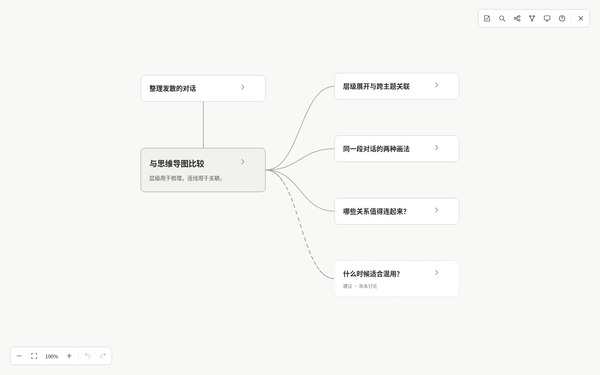

# Mindweave

把零散的对话，编织成可以继续探索的思路。

**Mindweave = mind（思考、心智）+ weave（编织）。** 面向 Codex、Claude 等 agent 的轻量会话画布，保留讨论的主题、联系、来源与未展开的支线。

已支持 **手动整理对话 → 阅读和编辑画布 → 再次整理 → 引用回读继续讨论**。Codex 可读取当前会话；其他兼容 Agent Skills 的工具可通过通用会话 JSON 导入，无需额外账户、云服务或模型 API 密钥。

主画布已采用 Excalidraw，保留原来的阅读卡片、数据格式和保存回读流程；迁移范围和验证见 [Excalidraw 迁移验收](docs/validation/excalidraw/README.md)。



无参数预览展示内置样例。整理当前对话后，会打开对应的真实会话画布。

## 用户安装

在 Codex 中通过内置安装器安装完整 skill：

```text
$skill-installer 从 tracyxiong1/mind-weave 安装 .agents/skills/mindweave，分支 main。
```

然后请求：`$mindweave 整理当前对话并打开画布`。

skill 自带 CLI 和页面，只需要 Node.js 22.12+，无需克隆源码或 npm 安装。自动读取 Codex 历史时另需 Codex CLI；其他兼容 Agent Skills 的工具可安装同一目录，通过通用会话 JSON 导入。不同宿主的原生历史读取尚未提供。

数据默认在 `~/.mindweave/`，查看时服务按需启动，存量项目文件保持原样。最新版随 `main` 的完整 skill 分发；仓库保留的 `0.3.1` npm 压缩包是历史构建，未包含后续 Excalidraw 迁移和交互修复，尚未发布 npm registry。[安装、通用输入与恢复说明](docs/installation.md)。

仓库自带项目级 skill，个人安装版位于宿主的用户 skill 目录。两份同时被发现时，补全列表可能显示项目名和 **Personal** 两项。`git pull` 只更新仓库；个人版需单独更新完整 skill 目录，包括运行时和页面资源。

## 源码开发启动

需要 Node.js **22.12 或更新版本**（本次验证为 22.16.0）和 npm。

```bash
npm ci
npm run dev
```

在运行服务的机器上访问 <http://localhost:5173>。服务监听 `0.0.0.0:5173`，端口占用时明确报错，启动不会自动打开浏览器。

如果代码运行在 Devbox，通过现有 SSH 连接转发端口。在你自己电脑的终端运行（将 `你的Devbox主机` 替换为平时 SSH 使用的主机或别名）：

```bash
ssh -N -L 5173:127.0.0.1:5173 你的Devbox主机
```

保持终端连接，在自己电脑的浏览器中打开 <http://localhost:5173>。本机 5173 被占用时，使用 `-L 15173:127.0.0.1:5173`，访问 <http://localhost:15173>。也可以在编辑器的端口面板中转发远端 5173。Devbox 的内网 IP 不一定能从用户浏览器直接访问。

构建和查看构建产物：

```bash
npm run build
npm run preview
```

产物在 `dist/`，预览端口为 4173。`npm run preview` 也提供真实画布的本地 API；仅静态托管 `dist/` 无法读取 Codex 文件。内置样例和浏览器草稿按 origin 保存，端口改变后这些缓存的范围也会改变。

## 在 Codex 中使用

GitHub skill 提供完整的用户级 `$mindweave`，可在自己的项目中使用；源码仓库内的项目级 skill 使用相同预构建入口。请求：

```text
$mindweave 整理当前对话并打开画布
```

Codex 只读捕获当前会话，由当前 agent 提炼带真实来源的节点与关系，再打开本地预览。skill 页面编辑保存到服务机器上的 `~/.mindweave/`；直接运行源码 CLI 的开发模式仍在仓库 `.mindweave/`。后续整理保留人工字段、位置、删除和合并。需要再次整理时请求 `$mindweave 更新当前画布`；它只更新数据。

在节点中复制引用，粘贴回 Codex 并提出问题；skill 先读取最新保存内容，再继续讨论。CLI 提供 `capture`、`apply`、`open`、`read` 和 `status`，源码开发通过 `npm run mindweave -- <命令>` 调用；具体参数、Devbox 地址、来源规则与恢复方法见 [Codex 集成说明](docs/codex-integration.md)。实际验证使用 Codex CLI 0.159.2，无需再配置模型 API 密钥；尚未提供每轮自动触发。

## 当前可以做什么

| 能力 | 当前支持 |
| --- | --- |
| 阅读与查找 | 点击标题、卡片空白或箭头展开；查看摘要、说明、原文摘录和完整消息；按标题、摘要或稳定引用查找 |
| 人工编辑 | 双击修改标题和摘要；通过标题栏内的 `…` 添加笔记、连接、管理关系、合并或删除节点 |
| 平移与缩放 | 拖动空白或连线平移，拖动卡片移动节点；滚轮平移、长详情内部滚动；显示缩放比例，点击恢复 100% |
| 分支与布局 | 多个独立分支共用会话主题根节点；按实际尺寸避让；一键整理分支布局并支持一步撤销 |
| 撤销与保存 | 保留最近 40 步撤销/重做；自动保存内容、人工修改、位置、展开状态、视口和主题 |
| 更新与回读 | 再次整理保留人工字段、笔记、位置、关系及删除/合并记录；稳定引用读取最新保存内容，改标题或合并后仍可使用旧引用 |
| 主题与恢复 | 跟随系统或切换明暗主题；断网草稿、保存失败提示、冲突恢复及 JSON 导出 |

选中节点只改变查看状态。画布没有聊天输入框，也不会修改原对话或发送 agent 消息。AI 建议保持虚线并标记“尚未讨论”；手工内容标为用户笔记，不冒充对话来源。

窄预览保留可读字号，完整图通过平移查看。展开和折叠保持当前视角，拖动结束不会误触折叠；查找或稳定引用定位会主动移到对应节点。节点菜单保持正常尺寸并避开窗口边缘，双击原文可选字。使用说明与保存详情在右上角 `?` 内。

默认沿分支显示主干连线，选中节点时显示全部直接关联并淡化无关内容；右上角可切换“显示全部关联”。所有关系仍保留在数据与“管理关系”中。“整理布局”会重新排列当前节点，包括手动移动过的节点，可一步撤销恢复原位置。

展开内容时的避让是临时展示偏移，保留保存的节点锚点和固定标记；折叠后重新从这些位置排布。拖动落点才会保存为人工位置，并只记一步撤销。连线、适应画布和引用定位都使用避让后的展示坐标。

## 稳定引用

```text
mindweave://canvas/mw-branches/node/comparison
```

身份只依赖画布 ID 和节点 ID。点击右上角“定位引用”，粘贴并定位；也支持在页面 URL 中使用 `#ref=<URL 编码后的引用>`，例如：

<http://localhost:5173/#ref=mindweave%3A%2F%2Fcanvas%2Fmw-branches%2Fnode%2Fcomparison>

纯解析入口是 `src/core/references.ts` 的 `parseReference` 和 `resolveReference`。解析会区分格式错误、其他画布、已删除和不存在的节点。合并的旧 ID 可连续解析到当前节点；删除后不会悄悄跳到其他内容。

Codex 可通过 `$mindweave` 的 `read` 入口读取真实画布中的稳定引用；内置样例引用用于浏览器内定位。尚未注册操作系统协议或原生 `@` 补全。浏览器无法使用 Clipboard API 时会显示可手工复制的引用。

## 保存位置与范围

**内置样例**保存在当前浏览器、当前 origin 的 localStorage，按画布独立保存，例如：

```text
mindweave:v1:canvas:mw-branches
```

格式版本为 `schemaVersion: 1`。生成节点/关系、人工编辑/笔记/关系/删除记录/合并映射，以及视图位置分别保存；用户只改标题时不会冻结未改过的摘要。撤销使用对应字段的差异记录，不回滚整张图。

内置样例不跨浏览器、设备、域名或端口同步；清理站点数据会丢失内容。容量不足或存储被禁用会明确显示保存失败，当前页面的编辑仍可导出。损坏或未知版本的数据不会被自动覆盖。JSON 导出用于备份，当前没有导入界面。

**导入会话画布**保存在服务机器的运行目录 `canvases/<canvasId>.json`，安装版默认运行目录是 `~/.mindweave/`，开发模式为仓库 `.mindweave/`。浏览器另保留未确认草稿。CLI 读取服务器上最后一次成功保存的人工内容；网络失败时保留草稿并提示。不同浏览器可通过带凭据链接访问同一画布，人工编辑并发冲突会停止覆盖并提供备份恢复。私人运行数据不会打入分发包，导出的真实画布包含对话与摘录。详情见 [保存与冲突规则](docs/codex-integration.md#更新冲突与恢复)。

## 样例与键盘

图数据与原始消息分别位于 `src/data/*.graph.json` 和 `src/data/*.conversation.json`。来源以稳定 ID 和消息内范围定位，不生成虚假的宿主跳转链接。

- 默认的[多次分叉样例](http://localhost:5173/?sample=branches)；另有[学习型](http://localhost:5173/?sample=learning)和[方案讨论型](http://localhost:5173/?sample=planning)，各自保存。也可从使用说明中切换。
- `Tab` 切换焦点；节点聚焦后 `Enter` 展开、`F2` 编辑、`Delete` 删除、`Esc` 取消编辑或关闭菜单/对话框。
- `Ctrl / ⌘ + 方向键` 移动节点 10 像素，配合 `Shift` 移动 40 像素。
- 拖动空白或连线、滚动或聚焦画布后用方向键平移；长详情内部滚动阅读，`Ctrl / ⌘ + 滚轮` 缩放。
- 节点操作菜单内可用 `↑` / `↓`、`Home` / `End` 选择操作，`Esc` 关闭并返回按钮。
- `Ctrl / ⌘ + Z` 撤销，配合 `Shift` 重做。

## 开发与验证

React + TypeScript + Vite，使用 `@excalidraw/excalidraw@0.18.1` 绘制原生场景并处理空白平移。HTML 阅读层保留详情、来源和表单，Mindweave 数据模型继续负责布局、编辑与持久化撤销。依赖版本锁定在 `package-lock.json`。

页面和所用 UI 字体均随本地构建及 skill 提供；第三方声明位于产物的 `THIRD-PARTY-NOTICES.txt`。`npm run dev:excalidraw` 保留原 5180 端口，但使用同一份正式实现；默认开发端口仍为 5173。

```bash
npm run check      # 类型检查、数据测试、生产构建
npm run test:e2e   # Chromium 交互、Codex 画布回读、持久化与恢复
npm run test:build # 生产构建的阅读、编辑、主题与恢复回归
npm run test:skill # 独立 skill 安装、通用导入与浏览器闭环
npm run test:install # npm 安装、存量项目首次使用与 Codex 闭环
npm run build:skill # 更新随 GitHub skill 分发的 CLI 和页面
```

浏览器测试优先使用 `/usr/bin/chromium`（若存在），或通过 `PLAYWRIGHT_CHROMIUM_EXECUTABLE_PATH` 指定。没有系统 Chromium 时先运行 `npx playwright install chromium`。E2E 会启动 5173 服务或复用当前服务；失败的截图与 trace 在 `test-results/`。明暗和窄视口验收截图在 `docs/validation/`。

截至 2026-11-02，类型检查、94 项单元测试、31 项开发浏览器回归、27 项生产构建回归和 skill 构建均通过。阅读与手势回归覆盖窄窗口展开、拖动与点击、菜单边界、详情滚轮和连线平移；具体验收范围见 [功能对齐记录](docs/validation/excalidraw/parity.md)。

## 文档与后续边界

- [产品规则](docs/product.md)
- [实施路线](docs/roadmap.md)
- [版本化数据契约](docs/data-contract.md)
- [Excalidraw 迁移与原版功能对齐](docs/validation/excalidraw/README.md)
- [概念图](docs/design/README.md)
- [验证记录与截图](docs/validation/README.md)

当前提供会话阅读和结构化编辑。自由绘图、任意原生图形、原生框选与复制粘贴尚未接入业务保存，完整卡片 PNG/SVG 导出也尚未提供；当前支持 JSON 导出。

Codex 集成使用带来源的追加/更新接口，保护人工层并校验重放与过期版本。通用 JSON 输入已独立于 Codex CLI 运行；其他宿主原生历史读取、完整轮次事件、每轮自动整理、原生 `@` 补全、系统协议、多人协作、账户和云同步尚未提供。

源码仓库：[tracyxiong1/mind-weave](https://github.com/tracyxiong1/mind-weave)。保留 [MIT 许可证](LICENSE)。
