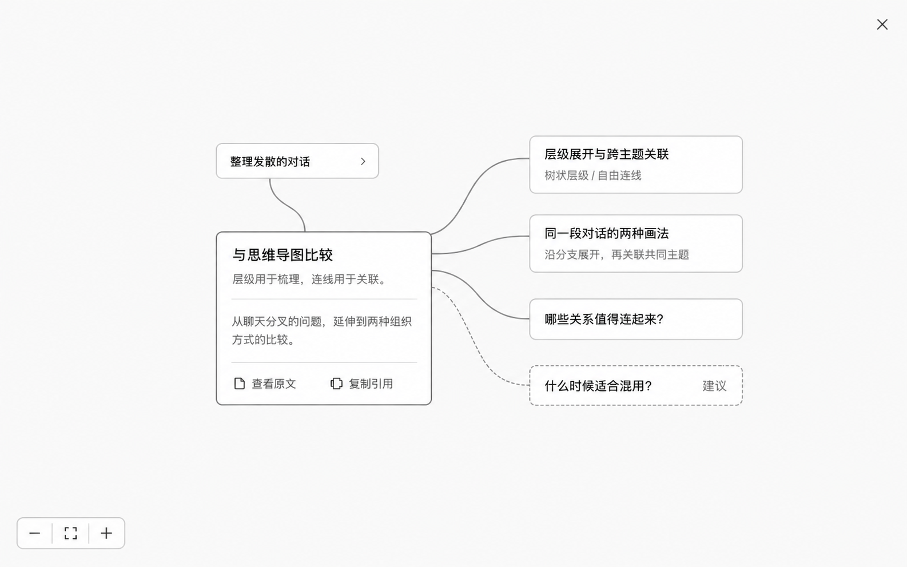
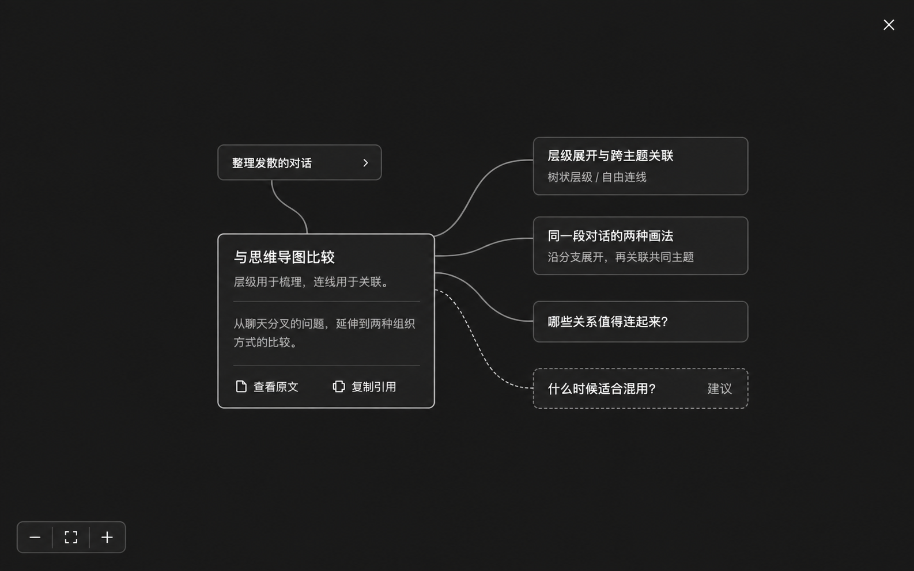

# 视觉方向

下面是本次讨论生成的静态概念图，不是已经实现的界面。两张图表现同一布局中的节点展开状态；默认阅读状态只露出标题和必要摘要。

## 实现时保留

- 简洁的节点和关系，没有固定的说明信息条。
- 明暗主题使用一致的布局与交互。
- 详情在节点内部按需展开，统一宽度和文字起点。
- 用虚线承接可选探索建议。
- 查看原文和复制引用作为轻量操作。

概念图尚未表现编辑态、键盘焦点、窄视口或大量节点布局。这些要在可操作原型中验证。图中的微小纹理和字号误差不作为像素级规范；实现使用平整背景、清晰文字和统一间距。

风格参考：[open-canvas](https://github.com/tracyxiong1/open-canvas)。本文保存的是本项目生成的概念图，不包含该仓库的源代码或媒体资产。
