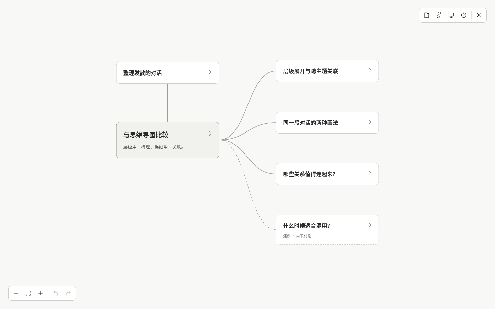
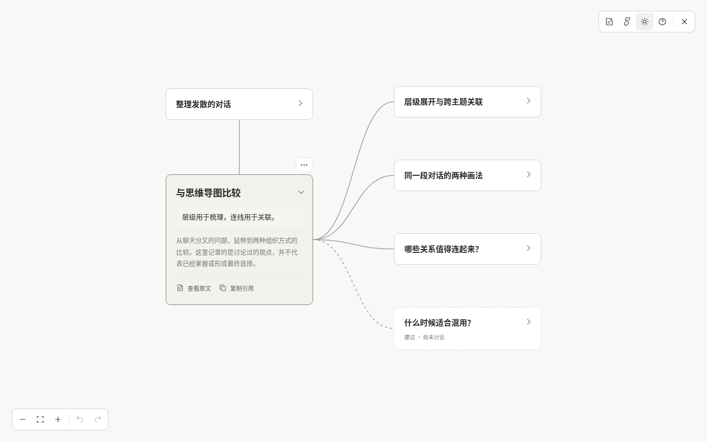
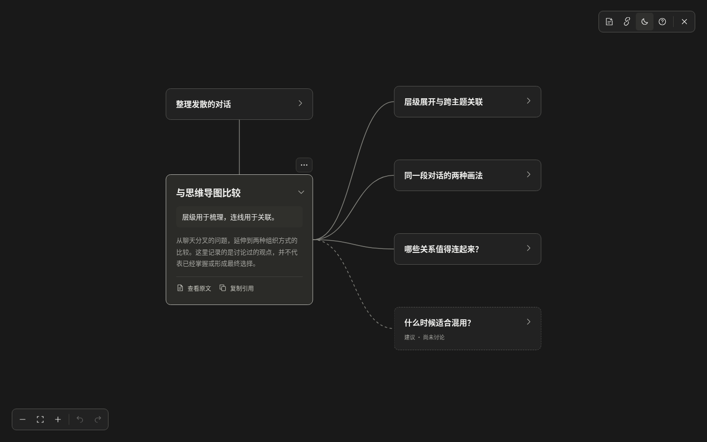
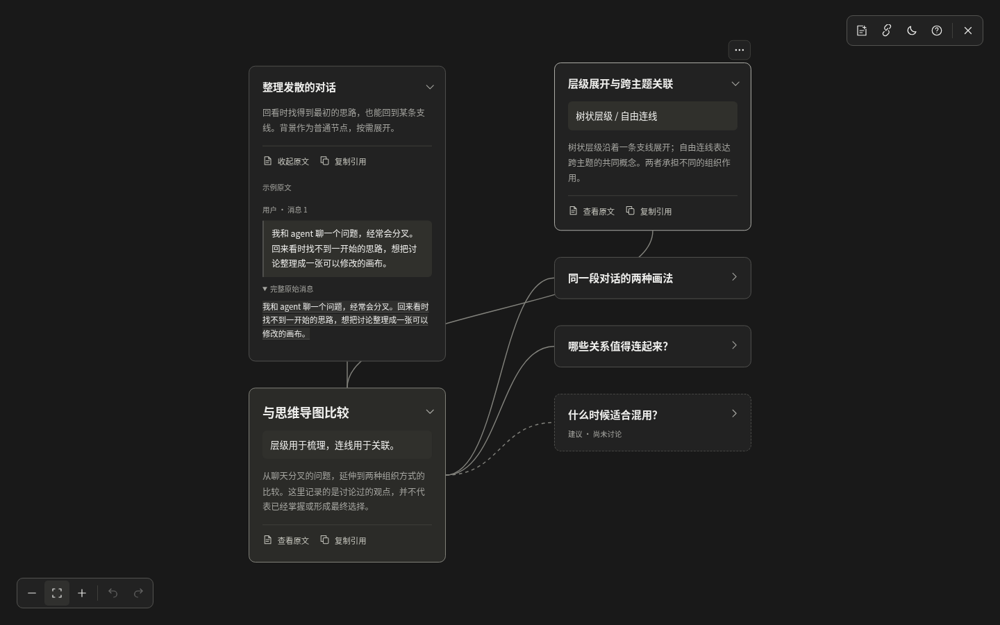
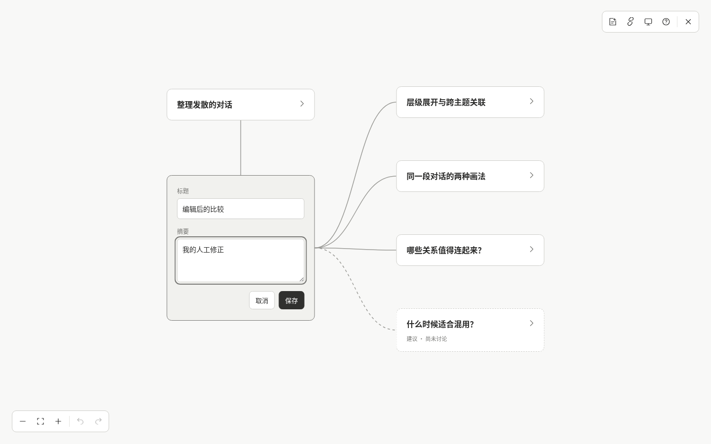
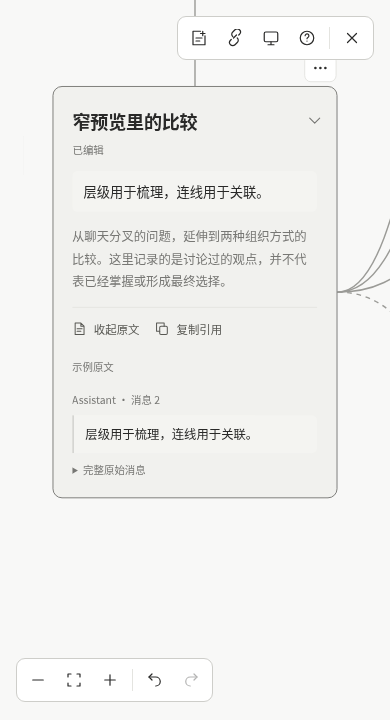

# 第一阶段原型验证

验证日期：2026-10-13（Asia/Shanghai）。以下保留第一阶段独立原型的验收记录；后续 Codex 集成的接口、真实闭环和检查结果见 [Codex 集成验证](../codex-integration.md#验证结果与边界)。

## 环境与结果

- Node.js 22.16.0、npm 10.9.2。
- React 19.3.0、TypeScript 5.9.3、Vite 8.3.4、Vitest 5.0.4、Playwright 1.64.0；依赖使用实际 npm 元数据确认并锁定。
- 浏览器：系统 Chromium 151.0.7922.108，真实无头浏览器交互与截图。
- `npm run typecheck`：通过。
- `npm test`：4 个文件、37 项数据与布局测试通过。
- `npm run build`：通过，静态产物在 `dist/`。
- `npm run test:e2e`：15 项浏览器验收全部通过。
- `git diff --check`：通过。

## 验收覆盖

| 验收项 | 实际验证 |
| --- | --- |
| 简洁明暗画布 | 同一展开节点在 1440 × 900 的明暗模式中尺寸与位置一致，主题刷新保留；默认不出现输入框或详情侧栏 |
| 阅读层次 | 默认只突出中心讨论节点的标题与摘要；支线摘要展开后出现，生成内容、用户内容和撤销历史保持不变；长说明可展开和收起 |
| 动态避让 | 展开背景原文、完整消息和多个详情后检查所有真实节点矩形的间距；编辑器和长摘要增高也会避让，折叠恢复保存锚点，不产生人工位置修改或撤销记录 |
| 拖动碰撞 | 真实鼠标拖到另一节点上，拖动预览与落点均无交叠；其他节点预览位置保持，保存只记一步，刷新与撤销均保持正确 |
| 旧布局恢复 | 注入已有重叠锚点，恢复后自动避让；引用聚焦与适应画布使用展示坐标，原保存位置不被改写 |
| 缩放 | 实际点击放大和使用 Ctrl + 滚轮后，展示节点尺寸与保存缩放一致；刷新保留视口 |
| 窄视口 | 390 × 720 中保留可读缩放；编辑、来源、平移到其他支线及离屏节点键盘定位均可用 |
| 保存恢复 | 真实鼠标拖动后确认坐标和固定标记；修改标题/摘要后刷新、关闭页面再新开，内容与位置保持 |
| 笔记与关系 | 新建笔记的来源为空且标为用户笔记；创建/移除关系、删除及撤销后检查所有展示关系端点 |
| 稳定引用 | 从浏览器实际剪贴板读取复制结果；改标题、合并、刷新后原引用都聚焦到正确节点；页面 hash 也使用同一解析器 |
| 来源 | 摘录与完整消息逐字对应示例原文；修改摘要不改变原始消息 |
| 键盘 | Enter 展开、F2 编辑、Esc 取消（输入框或按钮聚焦时）、方向键移动、Delete 删除、撤销/重做 |
| 数据损坏 | 在应用初始化前注入损坏数据；仍保留原始存储，可下载原数据并明确恢复示例 |
| 保存失败 | 模拟 `QuotaExceededError`，显示失败提示；当前人工编辑可导出为完整 JSON |
| 数据基础 | 用户字段保护、未改字段更新、不同样例隔离、连续合并、删除来源抑制、关系去重、局部撤销、版本/结构校验与撤销恢复 |

另在浏览器中实际确认了关闭/重新打开预览，以及学习型和方案讨论型样例各自加载 5 个节点，无页面运行错误。

## 预览访问

开发服务已在当前 Devbox 的 5173 端口启动，Devbox 本机 `http://127.0.0.1:5173/` 返回 HTTP 200，并用于上述浏览器检查。内网 IP 直接访问路径没有在当前访问链路中通过，不能当作用户可用的公开预览地址。

在自己的电脑使用现有 Devbox SSH 主机/别名转发端口：

```bash
ssh -N -L 5173:127.0.0.1:5173 你的Devbox主机
```

随后打开 <http://localhost:5173>。完整启动、备用端口与构建预览说明见 [README](../../README.md)。服务退出后需重新运行 `npm run dev`。

## 实际截图

截图由浏览器直接捕获，没有使用概念图充当运行结果。

默认阅读状态，节点全部折叠：



同一画布展开详情后的浅色与深色模式：





背景原文与完整消息展开，同时展开多个节点后的自动避让；保存的锚点保持不变：



标题和摘要的编辑态：



390 × 720 窄预览，已编辑节点并查看真实摘录：



## 第一阶段交付时的边界

- 第一阶段交付时尚未接通真实 agent、模型提炼或增量应用器；随后已接通 Codex 手动闭环。自动触发和原生 `@` 仍未实现。
- 数据仅保存于当前浏览器的当前 origin；不跨设备或浏览器同步。清理站点数据会丢失内容，提供 JSON 导出但没有导入界面。
- 第一阶段内置样例没有多标签页同步；真实 Codex 画布增加了文件版本检查与冲突恢复。
- 浏览器交互验证覆盖 Chromium，未进行 Firefox、WebKit 或真实手机触摸设备验收。
- 小规模确定样例用于本轮验证，未进行大量节点的性能验收。
