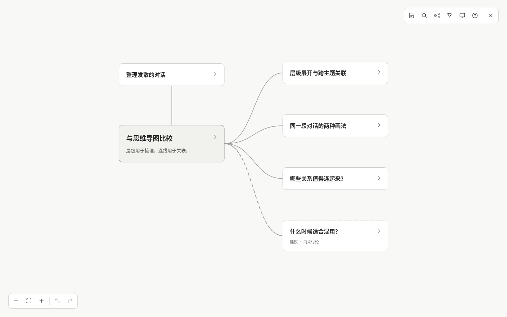
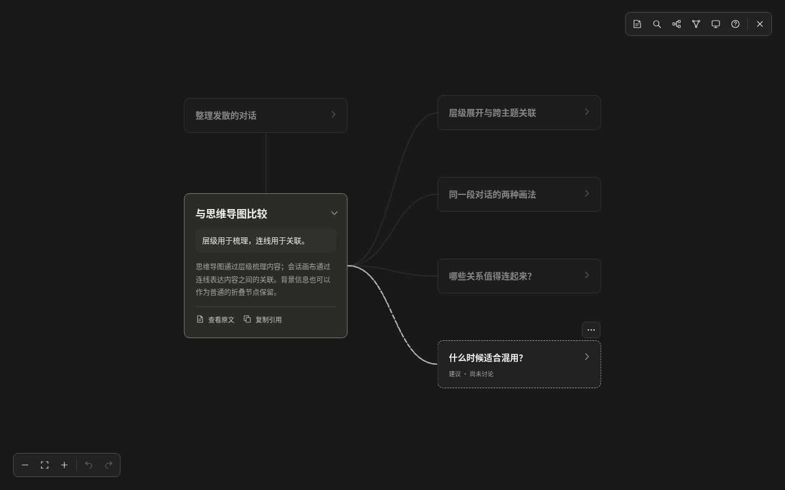

# Excalidraw 主画布迁移

日期：2026-11-02。版本：`@excalidraw/excalidraw@0.18.1`、React 19.3.0。默认入口、真实会话入口和原 5180 验证入口使用同一份正式实现，自包含 skill 同步构建该页面。

## 一、实现范围

Excalidraw 提供原生场景和视口；Mindweave 保留业务数据、阅读卡片、布局与保存流程。使用公开 React 组件和 API，未修改上游源码。

| 层 | 当前职责 | 主要文件 |
| --- | --- | --- |
| 业务数据 | 生成内容、人工字段、来源、合并、删除与持久化历史 | `src/core/`、`src/integration/` |
| 业务控制器 | 编辑、笔记、关系、键盘、引用、布局、异常恢复和真实会话连接 | `src/App.tsx` |
| 场景投影 | 稳定元素 ID、透明节点几何、可见关系与颜色；保留曲线和避障路径 | `src/canvas/scene.ts`、`routes.ts` |
| 视口适配 | 初始化、空白平移、缩放同步、系统配色和交互期间暂缓后台刷新 | `src/canvas/ExcalidrawSurface.tsx` |
| 阅读层 | HTML 卡片、表单、原文与完整消息、尺寸测量；SVG 只保留可访问的关系命中路径 | `src/components/NodeCard.tsx` |
| 分发资源 | 本地字体、第三方声明、预构建页面与独立 CLI | `build/excalidraw-assets.ts`、`scripts/build-skill.mjs` |

节点使用透明且锁定的原生矩形承载场景几何；可见卡片由 HTML 阅读层绘制。关系采用原有路由的原生线段投影，人工关系默认可见。当前没有依赖原生箭头绑定或 embeddable 激活状态实现日常阅读。

原生场景更新使用 `CaptureUpdateAction.NEVER`，业务命令仍由原来的模型执行并保存。临时展开、来源阅读和视口变化不会增加业务撤销步骤。平移时复用场景投影，避免每帧重新生成节点。

## 二、阅读与恢复

- 保留单层灰阶边框、主讨论强调、建议虚线、节点内详情、原文与稳定引用。
- 没有嵌入激活提示、外链角标、原生浮动工具栏或紫色选框；原生交互画布继续正常工作。
- 明暗使用显式投影配色，编辑器内部隐藏 UI 的主题保持稳定，避免初始化期间变更原生 UI 导致渲染循环。
- 文档恢复需要重新计算适应视口时，暂时保留当前视图，待布局完成后再同步原生视口，避免初始化值被反馈为用户平移。
- 保留原版全部操作入口，以及验证页增加的标题和摘要查找；Ctrl / ⌘ + K 可打开查找。
- 空白区域聚焦后，方向键和撤销仍由业务控制器处理；原生右键菜单与未接入保存的绘图快捷键不开放。

## 三、数据兼容

`CanvasDocument` 继续使用 `schemaVersion: 1`，真实会话沿用原加载器、API、浏览器草稿、服务器版本校验和 CLI 回读。没有把 Excalidraw 场景替换成业务存储格式。

内置样例在同一 origin 优先读取正式缓存；正式缓存不存在时，才读取旧 `excalidraw-experiment:` 验证草稿。迁移保留人工字段、位置和历史，新增来源重新检查会话身份、节点引用和原文范围。首次保存写入正式缓存，旧缓存保留。损坏的正式数据仍需先下载备份、再明确恢复，不会被验证页缓存覆盖。

示例说明只更新已知旧文案。自定义生成正文、人工层、增量后缀、历史以及真实会话内容不受此定向更新影响。完整功能对齐见 [对齐清单](parity.md)。

## 四、验收

测试使用隔离浏览器上下文、合成会话和临时运行目录，不修改用户实际画布。浏览器用例统一捕获页面异常；安装用例阻断外部 HTTPS 请求并检查本地字体和第三方声明。

| 检查 | 范围 |
| --- | --- |
| `npm run check` | 类型检查、94 项单元测试、生产构建 |
| `npm run test:e2e` | 共 31 项：18 项画布、4 项 Codex 保存链路、4 项引擎与恢复，以及 5 项阅读和手势回归 |
| `npm run test:build` | 相同生产页面的 27 项画布、恢复与阅读手势用例，覆盖压缩构建的初始化行为 |
| `npm run test:skill` | 独立 skill 目录安装、通用 JSON 导入、实际页面编辑与引用回读、再次整理保护、移动安装目录后重启、旧服务升级 |
| `npm run test:install` | npm 打包与安装、全局 CLI、skill 配置、实际页面保存回读与原项目保持 |

Codex 测试验证真实本地 API、文件保存和 CLI 读取，消息来自合成对话；没有调用模型或重新捕获用户的宿主历史。操作系统、原生输入法、触摸设备和其他浏览器的范围沿用既有验收边界。

以上检查均已通过。安装版在阻断外部 HTTPS 后完成浏览器编辑和回读，并验证字体与第三方声明均从本地服务返回。独立安装的明暗截图见 [浅色](portable-skill-light.png)、[深色](portable-skill-dark.png)。

## 五、资源与分发

生产页面及所用 Assistant UI 字体从同一 origin 提供。安装版的静态服务只新增所需字体路径和声明文件，继续拒绝包源码、私人文件和路径穿越。哈希资源保持长期缓存，固定名称字体在更新后重新校验。服务控制协议升为 3；下次打开会验证并升级旧服务，避免复用旧画布资源，原文件数据保留。

只打包当前 UI 使用的字体；未开放的绘图字体不进入正式产物。构建汇总实际打包模块及 Excalidraw 依赖树中的许可证，另补核心 MIT 与 Assistant OFL 声明，随网页和 skill 的 `assets/licenses/third-party.txt` 提供。

迁移完成时的单次生产采样（Chromium 151、1440×900、6 个示例节点；后续交互修复未重新采样）：

| 项目 | 结果 |
| --- | ---: |
| 全部静态产物 | 8,604,634 字节 |
| 全部 JS，含延迟加载模块与语言 | 7,838,022 字节 |
| JS 分别 gzip 后合计 | 2,577,769 字节 |
| WOFF2 字体合计 | 162,288 字节 |
| 首屏请求资源编码体合计 | 474,759 字节 |
| 首次就绪时间 | 约 0.58 秒 |
| 页面异常、外部请求、失败资源 | 0 / 0 / 0 |

数据见 [migration-metrics.json](migration-metrics.json)。构建总量包含延迟加载模块和声明文件，不等于首屏下载量；首屏资源统计不含 HTML 主文档和 HTTP 头。该采样没有承诺节点容量或持续帧率。正式 HTML 阅读层的 DOM 策略与早期 embeddable 原型不同，早期 100/500 节点性能数字仅保留在 [原型历史](prototype.md)。

`npm run build:skill` 更新仓库内自包含产物；`npm pack` 会构建匹配的 npm 包。此项迁移没有发布 npm registry 或替换已发布的版本压缩包。

## 六、后续边界

本次切换主画布并保留原版业务能力。任意原生图形、自由绘图、原生框选和复制粘贴尚未接入业务保存，正式页面不开放对应工具。完整 HTML 卡片的 PNG/SVG 导出仍需额外投影或截图实现；当前继续提供原版完整 JSON 备份。多人协作、账户、云同步和自动触发也保持后续范围。
