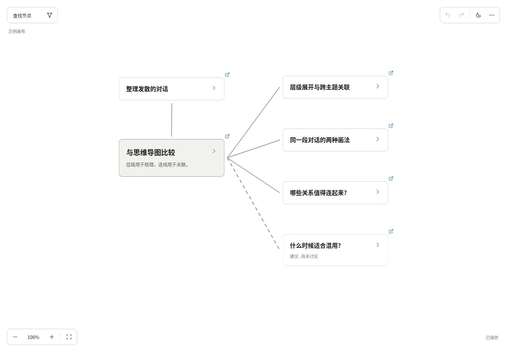
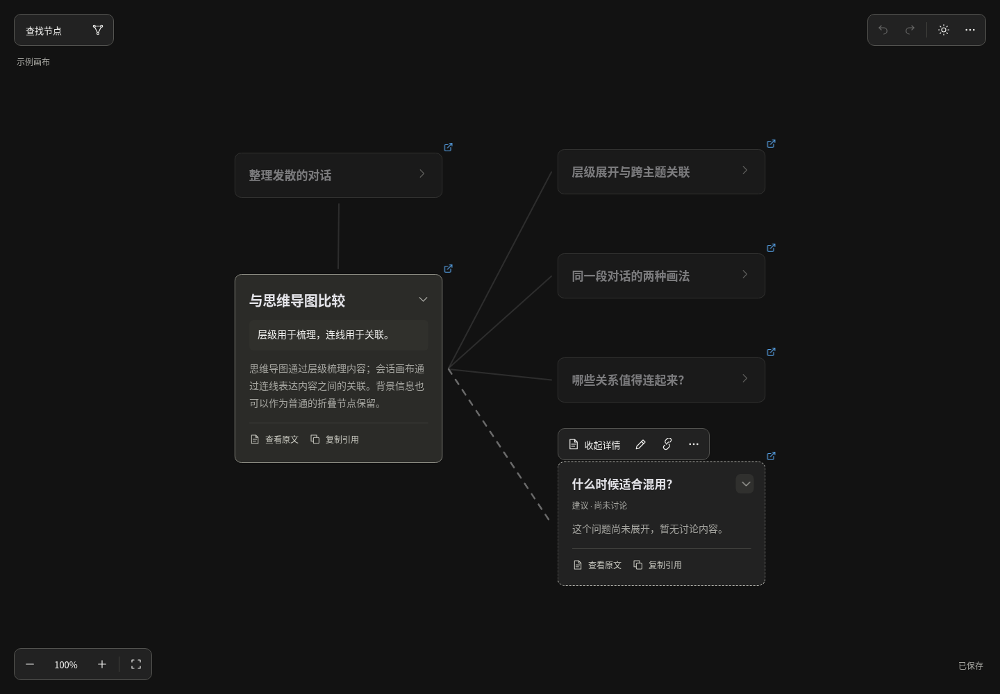
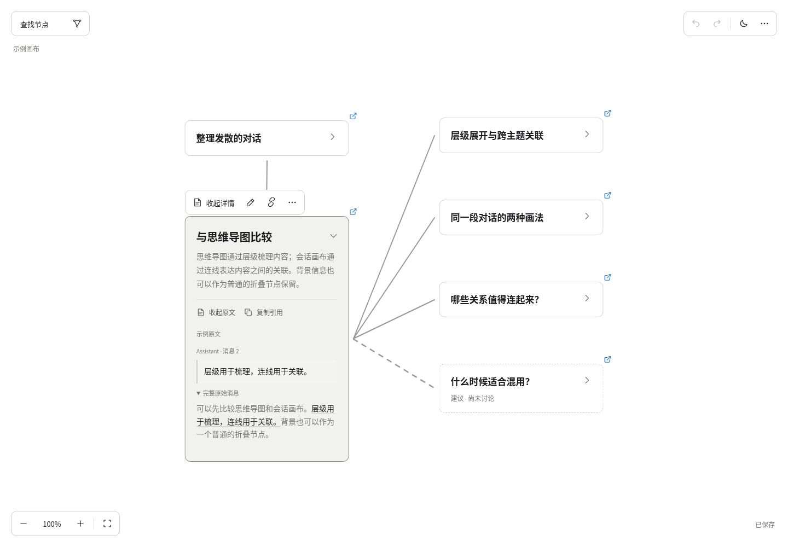
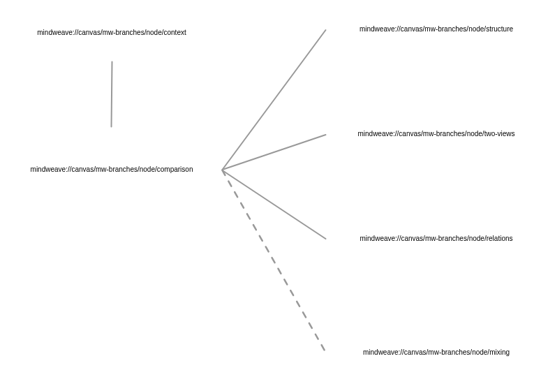

# Excalidraw 独立原型验证记录

> 历史记录：以下数据来自迁移前的 embeddable 原型。2026-11-02 主画布已改为原生场景与 HTML 阅读层；当时的独立实现和测量脚本已经合并或移除。原型的 DOM 数、性能结果和未完成项不代表当前主画布，当前状态见 [正式迁移验收](README.md)。

验证日期：2026-11-02。编辑器版本：`@excalidraw/excalidraw@0.18.1`。环境：Node.js 22.16.0、Chromium 151.0.7922.108、Linux Devbox、无头浏览器。

## 一、结论与采用建议

通过独立页面验证，Excalidraw 可以使用公开 API 承载现有 React 卡片，并与当前业务数据、增量应用和持久化撤销配合。未修改上游源码，也未通过 CSS 覆盖编辑器的鼠标事件或激活规则。

当前适合保留为实验方案。直接替换默认画布仍有三项成本：原生与 HTML 卡片之间的手势适配、React 内容的图片导出，以及更多的依赖和资源。若后续产品重点转向自由绘图、框选和白板编辑，继续集成有价值；若继续以会话阅读为主，当前 HTML/SVG 画布的交互与分发更直接。

实验复用了 `NodeCard`，没有为了接入白板重写一套卡片；同时保留 `CanvasDocument` 为业务数据源。验证入口、缓存和构建均独立，默认页面与现有 skill 产物没有引入编辑器代码。

功能范围尚未与原版全部对齐。真实会话闭环、布局整理、总根、异常恢复及部分关系显示和键盘行为仍有缺口；逐项核对和浏览器观察见[功能差异清单](parity.md)。下文的 10 项通过只表示实验用例通过。

## 二、已通过的浏览器验收

`npm run test:excalidraw`：**10 项通过**。

| 验收项 | 观察结果 |
| --- | --- |
| 展开与原文 | 单击箭头直接展开，并通过公开 API 激活卡片；详情、原文、完整消息和内部滚动可用 |
| 动态高度与布局 | 元素高度跟随实际卡片尺寸；展开只改变展示布局，不改保存锚点、生成内容或撤销历史 |
| 中文编辑与增量 | 中文组合输入事件、标题/摘要保存可用；实际调用现有 `applyGraphUpdate` 后，人工字段继续覆盖生成字段，刷新后新增原文来源仍可读取 |
| 撤销与刷新 | 人工编辑 → 生成更新 → 撤销，只撤销人工字段；重做、刷新后，人工内容和业务历史保留 |
| 拖动与业务撤销 | 分别验证收起与展开卡片的标题拖动；每次只产生一个业务历史条目，键盘撤销/重做与刷新后撤销可恢复位置 |
| 视口与主题 | 默认 100% 阅读比例，缩放、空格平移和主题切换可刷新恢复，不产生业务撤销历史 |
| 合并与旧引用 | 合并后旧节点引用定位到保留节点，复制引用仍使用业务身份 |
| 删除与再整理 | 删除合并后的节点会保留成员删除记录；再次生成更新不会恢复这些节点，撤销删除后可重新显示 |
| 关系管理 | 在卡片旁建立关联、选择目标、移除关系并撤销；全部关联开关可用 |
| 窄屏与主题 | 在 420×900 视口完成中文编辑与保存，深色主题下工具栏不重叠，原生移动端工具条已隐藏 |
| 阅读界面 | 悬停不显示嵌入提示或引用地址；点击卡片后的原生交互画布在卡片边缘区域没有选框或手柄像素；显式切换白板模式仍可用 |
| 示例详情与旧缓存 | 详情替换为示例原文支持的内容，未讨论建议显示暂无内容；旧版示例文案更新保留人工字段、位置、撤销历史、自定义详情和增量后缀 |
| 离线资源与原生导出 | 阻断外部 HTTPS 请求后，验收流程没有发起外部请求或产生页面异常；PNG/SVG 成功生成，但缺少 React 正文 |

中文输入测试使用浏览器组合输入事件和文字插入，没有覆盖各操作系统原生输入法候选窗。增量数据来自内置样例，测试没有调用模型或读取真实宿主历史。

额外检查：默认项目 `npm run check` 通过，包括类型检查、**85 项单元测试**和生产构建；原有画布的一项展开/数据不变性浏览器冒烟检查通过。独立实验的类型检查和生产构建也通过。另用 Chromium 检查了新增笔记、保存、Backspace 删除和键盘撤销，以及白板工具的显示与收起，均未出现页面异常。

## 三、接入时确认的机制

| 机制 | 实验中的处理 |
| --- | --- |
| 自定义内容 | 用 embeddable 元素和 `renderEmbeddable` 渲染现有 `NodeCard`；调整卡片样式，并收起桌面/移动端原生工具栏 |
| 图形身份 | 使用确定的元素 ID 与 `customData.nodeId`；程序化生成时关闭 ID 重生成 |
| 连线 | 使用绑定箭头，尺寸变化后重新投影节点与关系；默认使用主干关系，选中时补全该节点关系；新增与移除操作位于节点旁 |
| 初始化 | 等待编辑器装载初始场景后再做业务投影，避免装载过程覆盖提前写入的场景 |
| 手势快照 | Excalidraw 会原地修改元素对象，拖动前需复制快照；直接保留对象引用会漏掉移动 |
| 激活状态 | 避免普通点击后无条件重建场景；内容重排时同步更新激活元素的对象引用 |
| 尺寸测量 | 忽略离屏隐藏元素的零高度；内容变化经测量后更新元素高度，并沿用现有避让规则 |
| 唯一业务撤销 | 截获画布内的撤销快捷键，使用当前业务历史；手势结束后通过 `history.clear()` 清空编辑器内部历史 |
| 生成更新 | 使用 `CaptureUpdateAction.NEVER` 投影，避免把生成更新或临时布局加入编辑器历史 |
| 保存隔离 | 浏览器文档和新增来源索引的缓存键增加 `excalidraw-experiment:` 前缀；没有写正式画布文件或接通 CLI 回读 |

阅读模式使用公开的 `viewModeEnabled`，节点选择由业务界面管理，原生 `selectedElementIds` 保持为空。编辑器不绘制紫色选框或缩放手柄，节点保留自身普通描边。悬停通过公开 API 启用 HTML 控件，不选择节点；点击后才出现节点工具条。嵌入提示和挂到 body 的引用地址气泡由实验样式隐藏，鼠标命中层继续工作。

收起和展开卡片都使用标题拖动处理，共用手势前后快照与业务提交；详情滚动仍由 HTML 卡片处理。没有隐藏原生交互画布来掩盖选框，也没有保留不可见的原生缩放手柄。显式显示白板工具时，恢复原生选择与绘图。

页面标明“示例画布”。`sample.ts` 将旧版整理说明改成分叉对话原文支持的具体内容，未讨论的问题保留待讨论状态。旧缓存只更新已知的示例说明及其样例增量后缀，不覆盖其他生成详情；人工字段、位置、别名和撤销历史保持原值。

顶部保留查找、全部关联、撤销、重做、主题与更多入口；缩放固定在左下角。节点操作放在选中卡片旁，菜单位于 HTML 嵌入容器外，不受卡片裁切。测试按钮、场景数据和不完整的原生图片导出收进“开发验证”。卡片恢复圆角、主讨论强调和建议虚线；文字默认按 100% 展示。已有缓存继续保留原来的缩放，可点击左下角百分比恢复 100%。

查找与上下文菜单见 [search.png](search.png)、[node-menu.png](node-menu.png)。下图展示深色模式下展开详情与选择建议节点的结果：

## 四、导出边界

原生导出绘制 Excalidraw 元素，不会自动序列化 React 卡片的 DOM。实测 PNG 和 SVG 缺少标题、摘要和原文；外框样式与识别链接占位仍受原生导出规则影响。

“更多画布操作 → 导出画布数据”继续输出完整 `CanvasDocument`；原生图片导出位于“开发验证”。若产品需要可分享的图片，应增加业务图到原生图形/文字的导出投影，或单独实现 DOM 截图。当前实验没有实现这一补充。

展开后的页面：

原生 PNG 导出（验证 React 正文缺失）：

窄屏深色编辑截图见 [narrow-dark.png](narrow-dark.png)，原生 SVG 见 [native-export.svg](native-export.svg)。

## 五、构建与规模采样

未经资源裁剪的独立生产构建：

| 项目 | 字节数 | 说明 |
| --- | ---: | --- |
| 全部静态产物 | 21,169,404 | 约 21.17 MB，包括动态加载代码与全量字体 |
| 其中 WOFF2 字体 | 13,188,212 | 约 13.19 MB，便于验证字体自托管，尚未裁剪 |
| 全部 JS | 7,821,484 | 包括延迟加载的 Mermaid 等代码 |
| 全部 JS 分别 gzip 后合计 | 2,570,958 | 使用测量脚本的 Node.js gzip，包含非首屏代码 |
| 首次场景就绪前资源请求体合计 | 488,690 | 约 489 KB，以浏览器 `encodedBodySize` 统计；不含 HTTP 头与 HTML 主文档 |

默认画布同期构建总计 297,051 字节，其中 JS 为 285,427 字节。两份产物独立生成；实验依赖没有进入默认 JS。

下面为同一台 Devbox 上的单次生产预览采样，1440×1000 视口，每个规模使用新的浏览器上下文。就绪时间从浏览器导航开始计算，直到编辑器就绪且首个可见卡片的原生容器高度与卡片 DOM 高度一致。使用默认 100% 比例，不挂载 `?debug=1` 的自动化诊断输出。

| 数据节点数 | 就绪时间 | 就绪时卡片 DOM 数 | 平移采样帧间隔 P95 | 页面异常 / 外部请求 |
| --- | ---: | ---: | ---: | --- |
| 6 | 0.61 秒 | 6 | 16.8 ms | 0 / 0 |
| 100 | 0.62 秒 | 20 | 16.7 ms | 0 / 0 |
| 500 | 0.91 秒 | 20 | 16.7 ms | 0 / 0 |

更多节点并未全部进入当前视口；卡片 DOM 数体现了编辑器对可见 embeddable 的处理。帧间隔采样窗口约 1.5 秒，包含 40 步鼠标平移与后续等待，不能据此承诺持续帧率。此处没有测量移动设备、更多连线、全图展开或长时间编辑，也没有做与现有画布的同规模性能对比。

原始资源明细、环境和测量数据保存在 [measurements.json](measurements.json)，复现命令见[实验说明](../../../experiments/excalidraw/README.md)。

## 六、尚未覆盖的采用成本

- 自定义卡片完整图片导出。
- 原生新建箭头、任意图形、复制粘贴和卡片尺寸变化到业务数据的完整转换。目前原生工具可供观察，只有明确接入的业务操作会保存。
- 真实会话的服务端保存、并发冲突、CLI 回读和 skill 分发；本次只验证样例与浏览器缓存。
- 生产依赖处置。本次新增开发依赖后，`npm audit` 报告 11 项告警，其中 2 项 high 涉及 `lodash-es` 与 `nanoid` 的传递依赖。实验沿用发布包版本，未进行依赖升级或可利用性评估。
- 分发资源裁剪和全部第三方资源声明整理。本次保留上游核心 MIT 声明，完整字体随实验构建提供；该产物未发布。

采用判断：公开 API 足以完成本次验证闭环，主要不确定性已转为可明确估算的产品交互、导出、业务操作适配和分发工作。当前继续保留独立实验入口，不切换默认画布。
