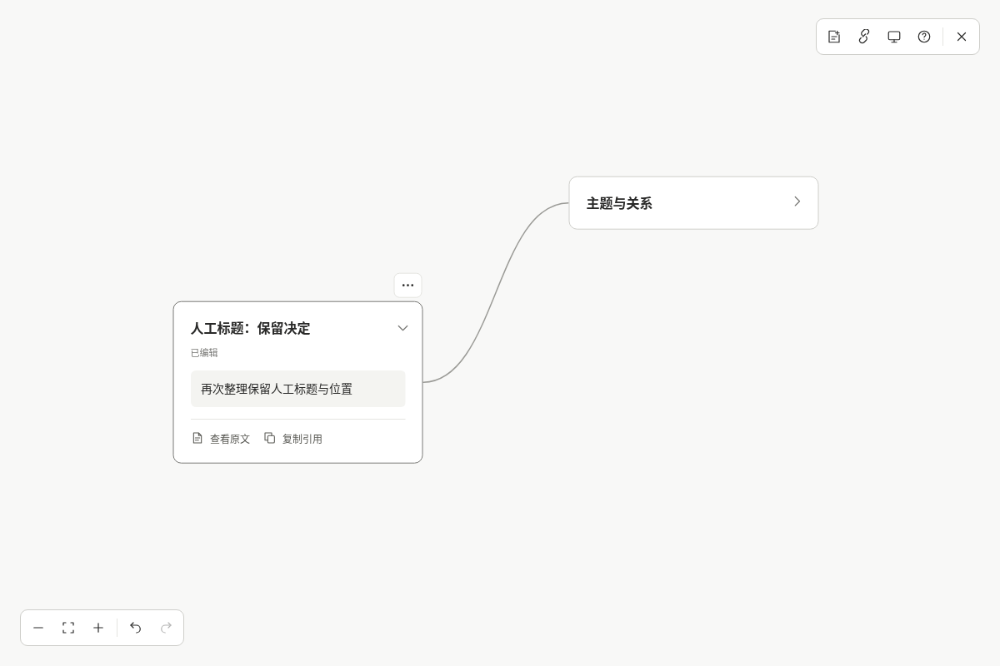
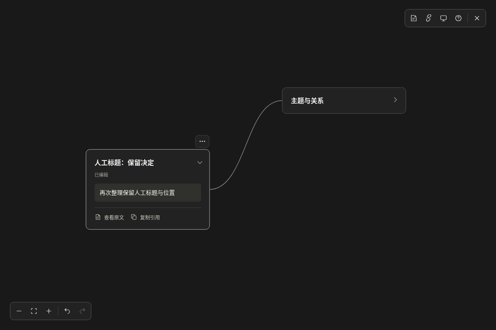

# 通用 skill 安装验收

验收日期：2026-10-14（Asia/Shanghai），版本 0.3.0。

## 已通过的检查

- Node.js 22.16.0、npm 10.9.2、Codex CLI 0.159.2、系统 Chromium。
- 类型检查、74 项单元测试、18 项浏览器交互测试、生产构建与官方 skill-creator 格式校验。
- 将完整 skill 独立复制到含空格的隔离用户目录，真实 Codex skills/list 确认可发现且启用。
- 设置 Codex 入口为不存在的路径，仍可从文件和标准输入导入通用 JSON；不依赖源码、tsx、npm 安装或绝对路径配置。
- 同 sessionId 不同 provider 生成独立画布；旧 Codex 画布身份与引用保持兼容。
- 浏览器真实打开、查看逐字摘录、编辑标题、移动节点、复制引用；CLI 回读最新人工修改。
- 追加对话后再次整理，人工标题与位置保留，未改摘要更新，刷新保持；同 ID 改写原文被原子拒绝。
- capture/apply 不启动预览，open 并发复用服务；验证并停止旧版服务后启动支持通用会话的新服务，不删除数据。
- 移动安装目录并重启服务后仍可回读，使用过程中安装目录文件与存量项目 Git 状态保持不变。
- npm 0.3.0 预打包安装、全局命令、完整用户 skill、原有 Codex 手动闭环回归通过。

## GitHub 实际下载与用户安装

公开 GitHub 提交 `a6277af414c33c30948c2eec5d8ab04c114dedf9` 的直接下载、官方安装器与完整浏览器验收已通过；安装的 15 个文件与仓库分发目录逐一匹配。之后使用同一官方安装器安装到当前用户的 `~/.codex/skills/mindweave`，没有覆盖已有 skill。

用户安装后的格式校验通过；在项目之外运行该入口，实际只读捕获当前 Codex 会话的 35 条文本消息，并确认没有启动预览。该真实捕获使用独立的私人验收目录，不覆盖原开发画布，也不提交真实文本。

下面截图来自公开的合成对话验收：人工标题与位置在再次整理后保留，摘要更新，明暗布局一致。





## GitHub 下载验收入口

```bash
MINDWEAVE_SKILL_TEST_REF=提交SHA MINDWEAVE_TEST_REAL_CODEX=1 npm run test:skill
```

此模式使用官方 skill-installer 的 `--repo`、`--ref`、`--path` 和 `--dest` 从公开 GitHub 直接下载安装，而不是读取本地 skill 目录；之后运行同一完整浏览器链路。安装器不会执行构建脚本。

## 范围

所有公开验收用合成对话，不含用户真实消息或访问凭据。通用会话 JSON 是宿主间的数据入口，不代表已自动读取 Claude、Cursor 等宿主的原生历史。尚未进行真实 macOS/Windows 或非 Chromium 浏览器验收。
